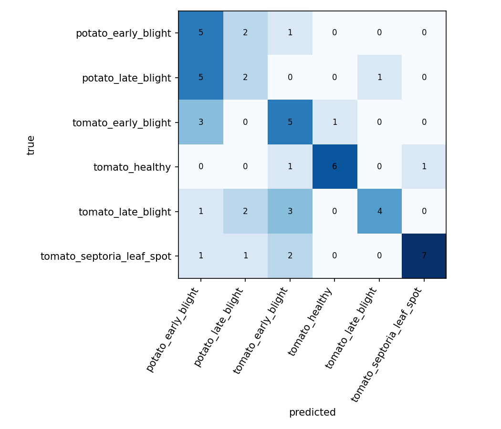
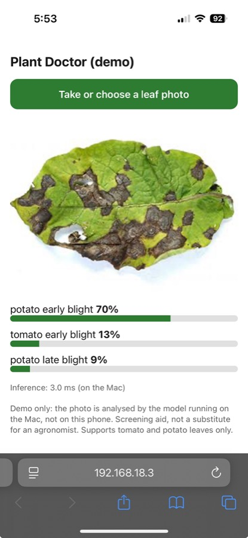

# Plant Disease Detection on the Edge

Tomato and potato leaf-disease classification, built around one question: models that reach about 99% on lab images
(PlantVillage) do much worse on real field photos (PlantDoc). How much of that gap can augmentation and field data close,
and what does compression for a phone cost?

## Headline results
Single training run per experiment (seed 0). The field test set has only 54 images, so differences of a few images are not reliable.

| Experiment | Training data | Lab accuracy (n=829) | Field accuracy (n=54) |
|---|---|---|---|
| E1 | PlantVillage, basic augmentation | 98.6% | 40.7% |
| E2 | PlantVillage, strong augmentation | 98.7% | 37.0% |
| E3 | PlantVillage + PlantDoc, strong augmentation | 99.5% | 53.7% |

- The gap between lab and field is large, about 58 points for the baseline.
- Adding field photos (E3) scored highest in this run, but its 95% interval (41 to 66%) overlaps the baseline's (29 to 54%).
- TFLite fp16 (1.9 MB) matched the full model exactly. Post-training int8 (1.2 MB) lost about 18 points of field accuracy.
- Full tables, calibration, Grad-CAM analysis and limitations: [`docs/RESULTS.md`](docs/RESULTS.md). Raw metrics: `docs/metrics/`.




## Status
- Training, evaluation, TFLite export and Grad-CAM were run (training on Google Colab, T4 GPU).
- A phone demo was tested on an iPhone, but **the model runs on the laptop, not the phone** (see below).
- The Flutter app in `app/` is written but **has not been compiled or run**, so there are no on-device latency measurements.
- Six classes only: potato early/late blight, tomato early/late blight, tomato septoria leaf spot, tomato healthy.
  PlantDoc has no healthy-potato class, so that class was dropped.
- Screening aid only, not a substitute for an agronomist.

## Layout
- `src/prepare_data.py` unify PlantVillage and PlantDoc into splits (`pv_train/val`, `pd_train/val`, `pd_test`)
- `src/train.py` MobileNetV3-Small, transfer learning, two-phase fine-tuning
- `src/evaluate.py` accuracy, macro-F1, confusion matrix, ECE/NLL, selective prediction, temperature scaling (`.keras` and `.tflite`)
- `src/export_tflite.py` fp32 / fp16 / dynamic / int8 variants and sizes
- `src/gradcam.py`, `src/gradcam_grid.py` Grad-CAM for one image or a model comparison grid
- `src/make_app_assets.py` copy model, labels and calibration into the app
- `demo/server.py` local web demo; `app/` Flutter app; `scripts/run_experiments.sh` the full study

## Reproduce
Use Python 3.10 to 3.12 (TensorFlow does not support the newest Python versions). Training is slow on a CPU, so a GPU (for example Colab) is recommended.
```bash
pip install -r requirements.txt
python -m pytest tests

# Download PlantVillage and PlantDoc yourself (see Data and credits), then:
python src/prepare_data.py --plantvillage <path/to/PlantVillage/raw/color> \
  --plantdoc-train <path/PlantDoc/TRAIN> --plantdoc-test <path/PlantDoc/TEST>
bash scripts/run_experiments.sh
```
Check the `prepare_data.py` printout: every class should have images in every split. Use the `color` folder only, not the grayscale or segmented copies.

## Phone demo (no Xcode needed)
`python demo/server.py` serves a web page from your computer. Open the printed address in a phone browser on the same Wi-Fi,
take a leaf photo, and see the top-3 predictions. The model runs on the computer, so this demonstrates the interface only.



## Flutter app (untested)
```bash
flutter create plant_doctor && cd plant_doctor
cp -r ../app/lib ../app/pubspec.yaml . && cp -r ../app/assets .
flutter pub get && flutter run    # use a real device for honest latency
```
On Android, if `tflite_flutter` complains, set `minSdkVersion 26`. On iOS add camera and photo-library usage descriptions to `Info.plist`.

## Known limitations
- The field test set has 54 images and each experiment was run once, so small differences are not reliable.
- PlantVillage has near-duplicate photos of the same leaf, so lab accuracy is optimistic. The PlantDoc test set is the real benchmark.
- Only two crops and six classes. The model cannot recognise anything else and still outputs one of the six.
- Calibration was fitted on 60 images. No out-of-distribution detection beyond a confidence threshold.
- int8 degradation was observed but its cause was not tested. No on-device measurements and no user study.

## Data and credits
The datasets are **not** included. Download them from their sources and follow their licences.
- **PlantVillage**: Hughes and Salathe (2015), arXiv:1511.08060; Mohanty, Hughes and Salathe (2016), Frontiers in Plant Science. Source: https://github.com/spMohanty/PlantVillage-Dataset
- **PlantDoc** (CC BY 4.0): Singh, Jain, Jain, Kayal, Kumawat and Batra, "PlantDoc: A Dataset for Visual Plant Disease Detection", CoDS-COMAD 2020. Source: https://github.com/pratikkayal/PlantDoc-Dataset

The Grad-CAM figure contains PlantDoc photos.

## Licence
Code is released under the MIT licence (see `LICENSE`).
