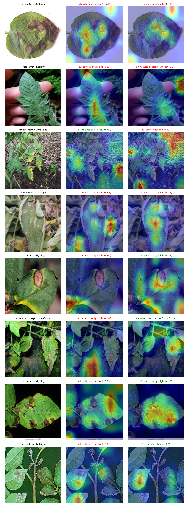

# Plant Disease Detection on the Edge

Offline tomato/potato leaf-disease screening on a phone, built around one research question:
**models that hit ~99% on lab images (PlantVillage) collapse on real field photos (PlantDoc). How much of that gap can
augmentation + field data close, and what does it cost to run on-device?**

## Status (read this first)
Written and syntax-checked, **not yet trained or run end to end**. The label-mapping logic is unit-tested.
No numbers exist until you run the pipeline on the datasets. Do not quote results before you have produced them.

## Layout
- `src/prepare_data.py` unify PlantVillage + PlantDoc into splits (`pv_train/val`, `pd_train/val`, `pd_test`)
- `src/train.py` MobileNetV3-Small, transfer learning, 2-phase fine-tuning
- `src/evaluate.py` accuracy, macro-F1, confusion matrix, ECE/NLL, selective prediction, temperature scaling; works on `.keras` and `.tflite`
- `src/export_tflite.py` fp32 / fp16 / dynamic / int8 variants + sizes
- `src/gradcam.py` check the model looks at lesions, not backgrounds
- `src/make_app_assets.py` push model + labels + calibration into the app
- `app/` Flutter app (camera/gallery, top-3, temperature-scaled confidence, "not sure" fallback, latency readout)
- `scripts/run_experiments.sh` runs the whole study

## Run it
```bash
pip install -r requirements.txt
python -m pytest tests                      # label-mapping tests

# Download PlantVillage and PlantDoc yourself (check each licence), then:
python src/prepare_data.py --plantvillage <path> --plantdoc-train <path/TRAIN> --plantdoc-test <path/TEST>
bash scripts/run_experiments.sh
```
Check the `prepare_data.py` printout: every class should have images in every split. If a PlantDoc folder name
isn't picked up, adjust `map_folder_to_label` in `src/common.py` and extend `tests/test_labels.py`.

## Build the app
```bash
flutter create plant_doctor && cd plant_doctor
cp -r ../app/lib ../app/pubspec.yaml . && cp -r ../app/assets .   # assets/model.tflite comes from run_experiments.sh
flutter pub get && flutter run                                      # real device, not an emulator, for honest latency
```
On Android, if `tflite_flutter` complains, set `minSdkVersion 26` in `android/app/build.gradle`.
For iOS add `NSCameraUsageDescription` and `NSPhotoLibraryUsageDescription` to `Info.plist`.

## Experiments
| ID | Train data | Augmentation | Purpose |
|----|-----------|--------------|---------|
| E1 | PV | basic | baseline; shows lab->field gap |
| E2 | PV | strong | does augmentation alone help? |
| E3 | PV + PD | strong | final model |
| C* | E3 compressed | fp32/fp16/dynamic/int8 | size / accuracy / latency tradeoff |

Fill in: accuracy and macro-F1 on `pv_val` vs `pd_test`, ECE before/after temperature scaling, TFLite sizes, and
on-device latency from the app on 2-3 phones (one low-end). Add battery drain and an airplane-mode demo.

## Thesis outline
1. Introduction and the lab-to-field problem 2. Related work 3. Datasets and unified label set 4. Method (model, augmentation,
compression) 5. Evaluation protocol (splits, metrics, calibration) 6. Results and ablations 7. App and on-device benchmarks
8. User test (5-10 people) 9. Limitations and future work (severity, OOD detection, more crops)

## Known limitations
- Only tomato and potato classes shared by both datasets, to keep the comparison clean.
- PlantVillage has near-duplicate photos of the same leaf, so `pv_val` is optimistic. `pd_test` is the real benchmark.
- PlantDoc is small and noisy, so run 3 seeds (`--seed`) and report mean and spread.
- No out-of-distribution rejection beyond the confidence threshold. Say so in the write-up.
- Screening aid only, not agronomic advice.

## Licence and data
Code is released under the MIT licence (see `LICENSE`). The datasets are **not** included; download them from their
original sources and follow their licences. Results template: `docs/RESULTS_TEMPLATE.md`.
## Phone demo (no Xcode needed)
`python demo/server.py` serves a web page from your computer. Open the printed address in a phone browser on the same
Wi-Fi, take a leaf photo, and see the top-3 predictions. The model runs on the computer, not the phone, so this is a
demo interface only. On-device latency needs the Flutter app (`app/`) on a real phone.

## Results at a glance
Lab accuracy is about 99%, but field accuracy is much lower (see `docs/RESULTS.md`). Raw metrics are in `docs/metrics/`.




